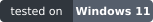
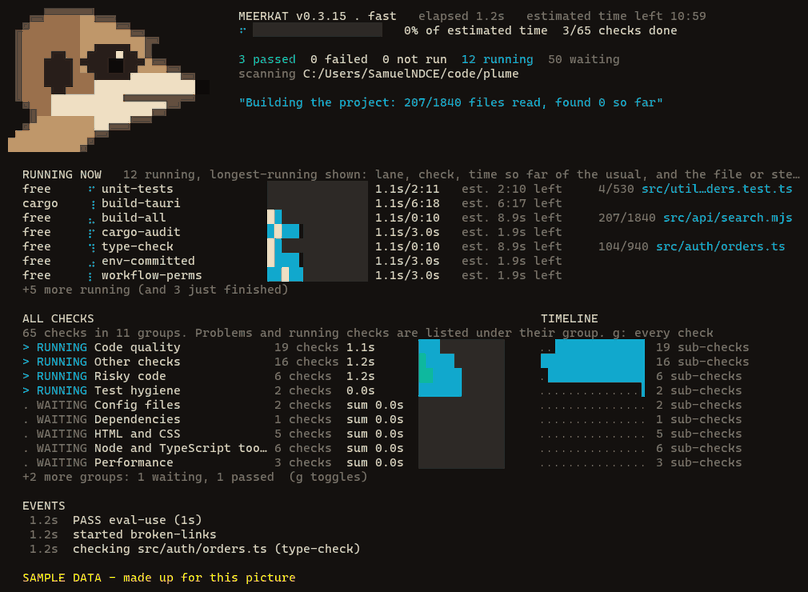

<div align="center">

# Meerkat

**A scanner for people, and a tool and scaffolding for AIs.**<br>
Meerkat checks, maps and tests a project: security, correctness, accessibility, performance and code health, with every result saved and explained.

          



<sub>Sample data: a made-up project, drawn by Meerkat's real screens.</sub>

</div>

## 💡 Why Meerkat

- **One command, an honest answer.** `meerkat verify` works out what applies to your project and says whether it is safe to ship. A check that could not run is NOT RUN, and the run fails.
- **Two ways to use it.** Standalone in a terminal (no AI, no account, no network), or with an AI over MCP, which uses the same checks to verify its own work.
- **Read-only and private.** It never edits your project, has no telemetry, and uploads nothing.

## 🚀 Quick start

You need [Node.js](https://nodejs.org) 20 or newer. No other dependencies.

```
npm install -g @samuelndce/meerkat
```

```
meerkat verify
```

```
meerkat full
```

```
meerkat last
```

`verify` is the quick everyday run, `full` adds the slow checks, and `last` shows the saved results. `meerkat why <check>` shows one check's log and `meerkat findings` lists every finding, worst first. Exit codes: 0 passed, 1 a check failed or could not run, 2 usage error, 3 nothing to run. Every command: [docs/commands.md](https://github.com/SamuelNDCE/Meerkat/blob/main/docs/commands.md).

## 🧩 Features at a glance

| Feature | What it does |
|---|---|
| 🔍 [Checks and presets](https://github.com/SamuelNDCE/Meerkat/blob/main/docs/features.md#checks-and-presets) | Runs the checks that fit your project; presets pick a set (`quick`, `bugs`, `full`, `ci`, `release`) |
| 🚦 [Gate on changed files](https://github.com/SamuelNDCE/Meerkat/blob/main/docs/features.md#gate) | Runs only the checks matching the files you changed; only failures in those files block, project-wide ones are listed and `--all` makes them block |
| 💨 [Smoke](https://github.com/SamuelNDCE/Meerkat/blob/main/docs/features.md#smoke) | `meerkat smoke` proves the checks chosen for your changes start and stop in time (it tests Meerkat, not your project); the `project-smoke` preset asks whether a change breaks your project |
| 💥 [Blast radius](https://github.com/SamuelNDCE/Meerkat/blob/main/docs/features.md#blast-radius) | Lists what an edit to a file or symbol affects |
| 📋 [Pre-edit brief](https://github.com/SamuelNDCE/Meerkat/blob/main/docs/features.md#pre-edit-brief) | One fast call before an edit: callers, tests, findings, churn and a risk tier |
| 🗺 [Codebase map](https://github.com/SamuelNDCE/Meerkat/blob/main/docs/features.md#codebase-map) | Writes a map of files, functions with line numbers, routes, tests and imports; only changed files are re-read, `meerkat map --check` says if it is current ([details](https://github.com/SamuelNDCE/Meerkat/blob/main/docs/codemap.md)) |
| 🧭 [Workflow profiles](https://github.com/SamuelNDCE/Meerkat/blob/main/docs/features.md#workflow-profiles) | `meerkat init --profile` solo, team, ai-agent, legacy, monorepo or ci-only prints a starting config and the commands for that workflow |
| 📝 [Memory hook](https://github.com/SamuelNDCE/Meerkat/blob/main/docs/features.md#memory-hook) | `meerkat memory` hands the newest run to an adapter you name in the config, which keeps it as a note outside the project |
| 🧪 [Red testing](https://github.com/SamuelNDCE/Meerkat/blob/main/docs/features.md#red-testing) | `meerkat redtest` attacks Meerkat itself with planted bugs and clean twins (repository checkout only) |
| 📏 [Real-code benchmark](https://github.com/SamuelNDCE/Meerkat/blob/main/docs/accuracy.md#real-code-benchmark) | Measures false alarms on real Rust code (repository checkout only) |
| 📚 [Test catalog](https://github.com/SamuelNDCE/Meerkat/blob/main/docs/features.md#catalog-and-tests-command) | `meerkat tests --json` lists every kind of test and what it proves |
| 🔌 [MCP server](https://github.com/SamuelNDCE/Meerkat/blob/main/docs/features.md#mcp-tools) | Offers the checks to an AI as tools, resources and prompts |
| 🧠 [Skills](https://github.com/SamuelNDCE/Meerkat/blob/main/skills/README.md) | Short guides that tell an AI when to reach for Meerkat |
| 🖱 [Click-through](https://github.com/SamuelNDCE/Meerkat/blob/main/docs/click-through.md) | Opens your real app and presses controls through a driver you supply |
| 🪝 [Hook safety](https://github.com/SamuelNDCE/Meerkat/blob/main/docs/features.md#hook-safety) | A git pre-push hook that runs the quick preset; removable cleanly |

<!-- counts:start -->
**400 checks · 1443 sub-checks · 50 suites.** A check is one scan or tool run; a sub-check is one rule inside it, so a failure names the exact rule. These are the checks Meerkat ships: any you add yourself are extra.
<!-- counts:end -->

How many checks exist: see [docs/features.md](https://github.com/SamuelNDCE/Meerkat/blob/main/docs/features.md), or run `meerkat tests --json`.

## 🧰 Everyday commands

Each example was run on a small test project. Counts of tools and checks are not typed here: `node bin/meerkat-mcp.mjs --list-tools` and `meerkat tests --json` print them. Full detail for each row: [docs/features.md](https://github.com/SamuelNDCE/Meerkat/blob/main/docs/features.md).

| Feature | What it does | Example |
|---|---|---|
| Gate, scoped | Checks the files you changed; failures elsewhere are listed, not blocking. `--all` blocks on everything, `--no-cache` re-runs every check | `meerkat gate --base origin/main` |
| Pre-commit | Call the gate from your own `.git/hooks/pre-commit`. `meerkat hook install` writes a pre-push hook (quick preset, ratchet), not a pre-commit one | `meerkat gate --staged` |
| Brief | One call before an edit: callers, tests, last-run findings, churn, risk tier | `meerkat brief src/app.ts#createApp` |
| Blast radius | What imports a file or symbol and which tests reach it | `meerkat blast src/app.ts` |
| Map | Writes `codemap.json` and `codemap.md`; `--check` exits 1 when the saved map is stale; `blast`, `brief` and the MCP map tool re-read stale files first | `meerkat map --check` |
| Ratchet | Accept today's findings, then fail only on new ones | `meerkat baseline`, then `meerkat run quick --ratchet` |
| Run flags | `--config`, `--no-config`, `--group`, `--fail-fast`, `--keep-going`, `--max-run-minutes`, `--timeout-scale` | `meerkat run --help` |
| Findings for CI | `--fail-on` sets the exit code, `--new` counts only new findings, `--export` points at the saved file | `meerkat findings --fail-on high --new` |
| Prompt for an AI | Every finding in full, with what to do | `meerkat prompt --print` |
| MCP scope | Tools that read a run take `folder`, `run` and `preset`, so a call stays on one project. Also `meerkat_version`, `meerkat_check_list`, `meerkat_prompt`, `meerkat_run_list`; `meerkat_run` takes `ratchet` and the run flags | `meerkat mcp install` |
| SKIPPED | A style tool the project never configured (eslint, prettier, stylelint) is SKIPPED with the reason, counted apart, and does not change the exit code. NOT RUN stays for a configured tool that cannot run | `meerkat last` |
| Commit messages | `commit-message-format` judges only commits not yet on the default branch (`git log <base>..HEAD`); with no base it checks the last 20 and says so | `meerkat why commit-message-format` |
| Workflow profiles | A starting config and the commands for `solo`, `team`, `ai-agent`, `legacy`, `monorepo` or `ci-only`; writes only with `--write` | `meerkat init --profile team` |
| Memory adapter | `meerkat memory` hands the newest run to the adapter named by the `memory` key in `meerkat.config.json` (shipped: `examples/neuralvault`, which needs `NV_VAULT_PATH` or `~/.neuralvault-vault-path`); nothing happens without the key | `meerkat memory --dry-run` |
| Release tools | The release gate (changelog, pack list, audit, secret scan, fix-needs-a-test), plus tarball and upgrade smoke tests. Repository checkout only. See [docs/release.md](https://github.com/SamuelNDCE/Meerkat/blob/main/docs/release.md) | `node tools/release/gate.mjs` |
| Update | Looks up the latest version once a day, installs only when you say so | `meerkat update --check` |
| Windows guard | On Windows a `!` in a command run through cmd.exe is refused when delayed expansion is on, or when the registry cannot be read in 3 seconds. No effect on Linux or macOS | automatic |
| Run estimate | The time estimate follows the newest runs and counts cached checks as nearly free | `meerkat quick --estimate` |

## Planned

The advisory scan, an offline match of declared packages against an advisory snapshot, is planned and not built as a command. Details: [docs/features.md](https://github.com/SamuelNDCE/Meerkat/blob/main/docs/features.md#advisory-scan).

## 🎯 Accuracy (summary)

Measured 2026-11-06 with `tools/corpus/gen-planted.mjs` and `tools/corpus/measure.mjs` (planted bugs and clean twins) and `benchmarks/real-rust/measure.mjs` (real code).

| Measure | Result |
|---|---|
| Planted-bug recall, default run | 99.77% (1735 of 1739). The 4 misses are lock-unwrap defects, hidden by design in the default run |
| Planted-bug recall, pedantic run (`--all`) | 100% |
| False alarms on real code (NeuralVault Rust benchmark) | 4.6%: 6 of 130 labelled findings were false, 124 true |
| False alarms on clean twins | 0 of 1739 |
| Real-code mutation run (200 mutants) | default 37%, all rules 98% |

**Caveat.** The planted corpus is built from each rule's own samples, so high recall there shows the rules do what they were written to do, not that they find every real bug. The real-code numbers matter more, and they cover one project in one language. Details, commands and what is not measured yet: [docs/accuracy.md](https://github.com/SamuelNDCE/Meerkat/blob/main/docs/accuracy.md).

## 🤖 Using it with AI

- **MCP server:** `meerkat mcp serve` offers its tools (`meerkat_list` or `node bin/meerkat-mcp.mjs --list-tools` gives the count and the names), read-only resources (`meerkat://run/latest/...`) and prompts. Tools that read a run take `folder`, `run` and `preset`, so an AI stays on its own project. `meerkat mcp install` registers it with Claude Code.
- **Skills:** the [skills](https://github.com/SamuelNDCE/Meerkat/blob/main/skills/README.md) folder holds short guides (before a commit, before a PR, blast radius before an edit, mapping unfamiliar code, and more).
- **Rule for agents:** a NOT RUN is never a pass, and never edit the config or turn a check off to make a run pass.

Everything an AI needs: [docs/ai.md](https://github.com/SamuelNDCE/Meerkat/blob/main/docs/ai.md).

## 🔧 Extending Meerkat

Add a command as a check in one line (`meerkat check new`), write a check in JavaScript in a pack, make a preset (`meerkat preset new`), or silence a known finding with a reason (`meerkat dismiss`). Prove a new check with a `selfTest` on a broken sample. How-to: [docs/adding-tests.md](https://github.com/SamuelNDCE/Meerkat/blob/main/docs/adding-tests.md) and [CONTRIBUTING.md](https://github.com/SamuelNDCE/Meerkat/blob/main/CONTRIBUTING.md).

## 🖱 Click-through

The driver protocol is built and Meerkat schedules, times and reports a driver like any check. The reference drivers have not yet run against a real app, so treat the shipped examples as unproven. Exit 75 from a driver means it could not start, never a pass. Guide: [docs/click-through.md](https://github.com/SamuelNDCE/Meerkat/blob/main/docs/click-through.md).

## ⚠ Known limits

- Rust findings are leads to check, not verdicts; the false-alarm figure is from one project.
- PLACEHOLDER: the smoke suite and the red suite on the `smoke-red-2026-11` branch are not merged into this branch, so nothing here is claimed about their results; `meerkat smoke` and `meerkat redtest` run what is in this branch.
- PLACEHOLDER: `meerkat update` (verify the new version in a copy, keep local changes, save a patch) and the trusted-publishing workflow are unit-tested but have not been run against a real newer published release.
- Red testing, the real-code benchmark and the release tools (`tools/release`) run from a repository checkout; the advisory scan is a library with no command yet.
- Recall on planted bugs measures what was planted, not real-world accuracy.
- If Meerkat reports something fine, open a [false alarm](https://github.com/SamuelNDCE/Meerkat/issues/new?template=false-positive.yml) issue; if it misses a real problem, open a [missed problem](https://github.com/SamuelNDCE/Meerkat/issues/new?template=missed-bug.yml) issue.

## 🔗 Links

| Read | For |
|---|---|
| [docs/features.md](https://github.com/SamuelNDCE/Meerkat/blob/main/docs/features.md) | Every feature, with its command and limits |
| [docs/ai.md](https://github.com/SamuelNDCE/Meerkat/blob/main/docs/ai.md) | Everything an AI needs |
| [docs/adding-tests.md](https://github.com/SamuelNDCE/Meerkat/blob/main/docs/adding-tests.md) | Adding checks, packs and presets |
| [docs/accuracy.md](https://github.com/SamuelNDCE/Meerkat/blob/main/docs/accuracy.md) | How accuracy is measured |
| [docs/commands.md](https://github.com/SamuelNDCE/Meerkat/blob/main/docs/commands.md) | Every command and flag |
| [docs/release.md](https://github.com/SamuelNDCE/Meerkat/blob/main/docs/release.md) | The release gate, tarball and upgrade tests, publishing and rollback |
| [CONTRIBUTING.md](https://github.com/SamuelNDCE/Meerkat/blob/main/CONTRIBUTING.md) | How to contribute |
| [CHANGELOG.md](https://github.com/SamuelNDCE/Meerkat/blob/main/CHANGELOG.md) | What changed |

Licence: [Perpetual Community Licence 1.0](https://github.com/SamuelNDCE/Meerkat/blob/main/LICENSE) ([notes](https://github.com/SamuelNDCE/Meerkat/blob/main/docs/licence-notes.md)). Security problems: [SECURITY.md](https://github.com/SamuelNDCE/Meerkat/blob/main/SECURITY.md).
