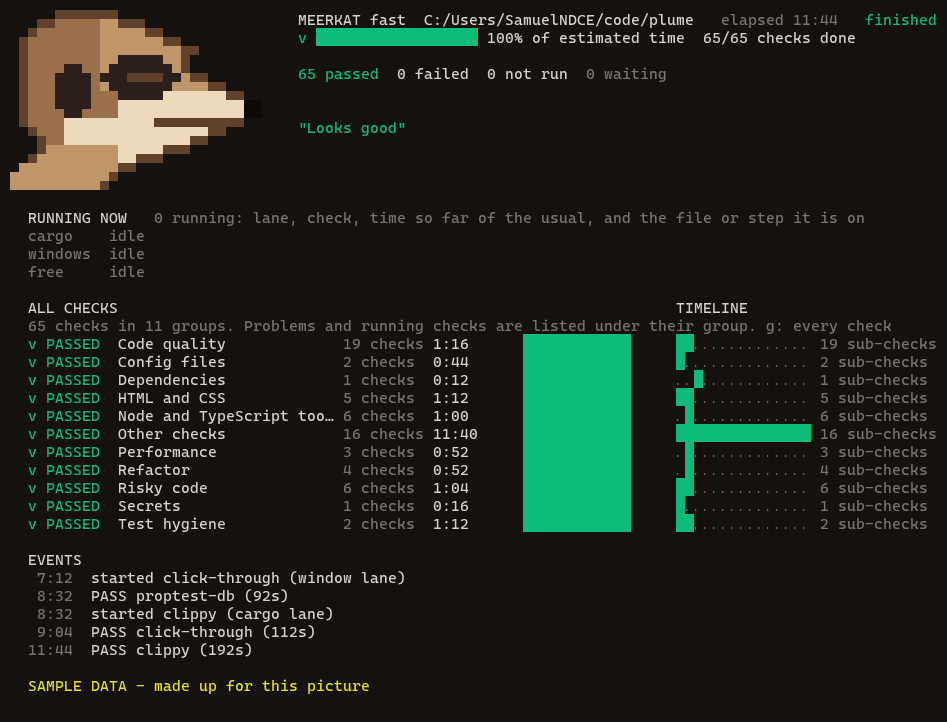

<div align="center">

# Meerkat

**One command that checks your app before you ship it.**
Builds it, runs every check it can find, opens the real app in a hidden window and clicks through it, then tells you plainly what passed, what failed and what could not run.

Node 20+ &nbsp;·&nbsp; no runtime dependencies &nbsp;·&nbsp; no telemetry &nbsp;·&nbsp; Rust, Node, Electron and anything git tracks


</div>

## Contents

[Why Meerkat](#why-meerkat) · [Quick start](#quick-start) · [Ways to run it](#ways-to-run-it) · [Every check](#every-check) · [What it works on](#what-it-works-on) · [How long it takes](#how-long-it-takes) · [Fast without crashing your PC](#fast-without-crashing-your-pc) · [Add your own check](#add-your-own-check) · [Configuration](#configuration) · [AI checks](#ai-checks-and-why) · [Privacy](#privacy-and-no-telemetry) · [In CI](#using-it-in-ci) · [The look](#the-look) · [Licence](#licence) · [Project layout](#project-layout)

## Why Meerkat

"Is this safe to push?" used to mean running ten commands in the right order and knowing which needed the Rust build first. Meerkat is one command, and it is built around five promises:

- **It looks at the real app.** It opens the app in a window parked off-screen, walks every page and control, presses them and reads the screen. A passing unit test cannot see a heading covered by a banner. This can.
- **It never passes quietly.** A tool that is not installed, a budget that is not set, a check that cannot start: all reported **NOT RUN**, and a run with a failure or a NOT RUN exits with an error. Nothing is skipped to look green.
- **It checks itself.** `--self-test` feeds every check a deliberately broken case and expects a failure, so a check that quietly stopped working is caught.
- **It never interrupts you.** Test windows cannot open File Explorer, pickers, dialogs or downloads, and cannot take focus.
- **It is fast and kind to your PC.** Light checks run together (up to ten), heavy ones run alone, and only one Rust build runs at a time.


## Quick start

You need [Node.js](https://nodejs.org) 20 or newer. There is nothing to install.

```
git clone https://github.com/SamuelNDCE/Meerkat.git
```

From the folder of the project you want to check, write a starting config for it (it detects Cargo and Node projects), then run:

```
node path/to/Meerkat/run.mjs --init
```

```
node path/to/Meerkat/run.mjs
```

To see the board without a project, play a fake run:

```
node preview.mjs --speed 6
```

## Ways to run it

`--preset` picks how much to run. `--list` shows every check, and `--estimate` says how long a run should take on your PC without running anything.

| Command | What it runs | Use it |
|---|---|---|
| `node run.mjs` | every quick check (same as `--preset quick`) | before every push |
| `--preset full` | everything, including the slow checks. The full run contains every check the quick one has, or a wider version of it | before a promotion or a release |
| `--preset security-fast` / `security` | the security checks, quick or all of them (fuzzing, mutation testing) | any time / before a release |
| `--preset ui-fast` / `ui` | the real-window checks, quick or complete | after a UI change |
| `--preset app-fast` / `app` | UI and functionality together | after a feature |
| `--preset performance-fast` / `performance` | size, dependencies, start-up, memory; the full one adds response time, load and build time | after a change that could slow things down |
| `--preset refactor` | duplicated code, dead code, files too long | before a clean-up |
| `--group security,ui` | any mix of `security`, `functionality`, `ui`, `performance`, `refactor` | your own mix |
| `--include ai` | also run the opt-in checks of that name (here, the AI ones) | when you want them |
| `--self-test` | proves every check still fails on a broken case | after changing Meerkat or a tool |

A focused run brings what its checks need (a UI check pulls in the build it waits for). Your own named runs go in `meerkat.config.json` under `presets`.

## Every check

This table is generated from the checks themselves (`node tools/gen-checks.mjs`), so it cannot drift from the code. **Weight** says how much of the machine a check needs, and **Typical time** is the written estimate; Meerkat learns the real time on your PC and uses that for the countdown.

<!-- checks:start -->
**63 checks** across 13 packs: 50 quick, 13 thorough, 3 opt-in. [Security 17](#security-checks) · [Functionality 27](#functionality-checks) · [UI 6](#ui-checks) · [Performance 8](#performance-checks) · [Refactor 5](#refactor-checks)

### Security checks

Secrets, known-vulnerable dependencies, unsafe code, risky scripts and AI review. 17 checks.

| Check | Tier | Weight | Time | What it does | Pack |
|---|---|---|---|---|---|
| `actionlint` | fast | tiny | 3 s | GitHub Actions workflows (actionlint) *(needs: actionlint)* | infra |
| `bandit` | fast | light | 10 s | Bandit: common Python security mistakes *(needs: bandit)* | python |
| `dependency-pinning` | fast | tiny | 3 s | Dependencies name a fixed version, not latest or * | security |
| `hadolint` | fast | tiny | 3 s | Dockerfiles (hadolint) *(needs: hadolint)* | infra |
| `license` | fast | tiny | 2 s | A license is declared, and no copyleft dependency slipped in | hygiene |
| `lockfile-integrity` | fast | tiny | 3 s | Locked packages are fetched securely and checksummed | security |
| `risky-code` | fast | tiny | 3 s | Risky calls: eval, shell strings, disabled TLS checks, weak hashes, plain http | security |
| `rust-audit` | fast | light | 4 s | Rust dependency advisories (cargo audit) | rust |
| `rust-deny` | fast | light | 10 s | Rust dependency policy: licenses, banned crates, sources (cargo deny) *(opt-in: `--include deny`)* *(needs: cargo-deny)* | rust |
| `secret-scan` | fast | tiny | 3 s | Secret scan: keys, tokens and private keys in tracked files | security |
| `sensitive-files` | fast | tiny | 2 s | No environment files, private keys or tokens are tracked | hygiene |
| `shellcheck` | fast | tiny | 3 s | Shell scripts (shellcheck) *(needs: shellcheck)* | infra |
| `unsafe-rust` | fast | tiny | 2 s | Every Rust unsafe block says why it is sound | hygiene |
| `workflow-security` | fast | tiny | 3 s | GitHub Actions: pinned actions, limited permissions, no script injection | security |
| `ai-diff-review` | thorough | light | 1.0 min | AI security review of the changes against the base branch *(opt-in: `--include ai`)* | ai |
| `ai-route-audit` | thorough | light | 5.0 min | AI audit of every route, handler and IPC channel *(opt-in: `--include ai`)* | ai |
| `npm-audit-all` | thorough | tiny | 5 s | npm audit, high severity, every dependency including dev ones | security |

### Functionality checks

Does it build, type-check, lint and pass its tests; is the repository in order. 27 checks.

| Check | Tier | Weight | Time | What it does | Pack |
|---|---|---|---|---|---|
| `broken-imports` | fast | tiny | 2 s | Every relative import points at a file that exists | hygiene |
| `conflict-markers` | fast | tiny | 2 s | No leftover merge-conflict markers | hygiene |
| `env-example` | fast | tiny | 2 s | Every environment variable the code reads is documented | hygiene |
| `eslint` | fast | light | 20 s | ESLint: the project's own lint rules *(needs: eslint)* | node |
| `go-test` | fast | medium | 1.0 min | go test: the test suite *(needs: go)* | go |
| `go-vet` | fast | light | 15 s | go vet: suspicious constructs *(needs: go)* | go |
| `json-valid` | fast | tiny | 2 s | Every tracked JSON file parses | hygiene |
| `large-files` | fast | tiny | 2 s | No oversized file or committed binary | hygiene |
| `links` | fast | tiny | 2 s | Every relative link in the documents resolves | hygiene |
| `local-links` | fast | tiny | 5 s | Links between documents and files (lychee, offline) *(needs: lychee)* | docs |
| `lockfiles` | fast | tiny | 2 s | Every manifest has its lockfile | hygiene |
| `markdownlint` | fast | tiny | 5 s | Markdown: well-formed documents *(needs: markdownlint-cli2)* | docs |
| `markers` | fast | tiny | 2 s | No FIXME or XXX notes left in the code | hygiene |
| `mypy` | fast | light | 30 s | mypy: type errors *(needs: mypy)* | python |
| `prettier` | fast | tiny | 10 s | Prettier: code is formatted *(needs: prettier)* | node |
| `pytest` | fast | medium | 1.0 min | pytest: the test suite *(needs: pytest)* | python |
| `ruff` | fast | tiny | 3 s | Ruff: lint and import order *(needs: ruff)* | python |
| `rust-clippy` | fast | heavy | 2.0 min | Rust lints (cargo clippy, warnings are errors) | rust |
| `rust-fmt` | fast | heavy | 4 s | Rust formatting (cargo fmt --check) | rust |
| `rust-test` | fast | heavy | 2.5 min | Rust tests (cargo test, the whole workspace) | rust |
| `scripts-resolve` | fast | tiny | 2 s | Every file an npm script runs exists | hygiene |
| `tsc` | fast | light | 15 s | TypeScript: no type errors *(needs: tsc)* | node |
| `typos` | fast | tiny | 3 s | Typos in code and documents *(needs: typos)* | docs |
| `whitespace` | fast | tiny | 2 s | No byte-order marks or mixed line endings | hygiene |
| `yamllint` | fast | tiny | 3 s | YAML files (yamllint) *(needs: yamllint)* | infra |
| `rust-build-release` | thorough | heavy | 5.0 min | Rust release build (cargo build --release) | rust |
| `rust-doc` | thorough | heavy | 1.0 min | Rust documentation builds without warnings (cargo doc) | rust |

### UI checks

Pages and styles: accessibility basics and valid markup. 6 checks.

| Check | Tier | Weight | Time | What it does | Pack |
|---|---|---|---|---|---|
| `css-contrast` | fast | tiny | 3 s | Text and background colours written together have enough contrast (WCAG 4.5:1) | ui |
| `html-structure` | fast | tiny | 3 s | Pages: one h1, headings in order, unique ids, labelled inputs, keyboard-reachable click handlers | ui |
| `htmlhint` | fast | tiny | 5 s | HTML: valid, accessible markup (htmlhint) *(needs: htmlhint)* | web |
| `meta-seo` | fast | tiny | 3 s | Pages have a title and description of a useful length | ui |
| `stylelint` | fast | tiny | 5 s | CSS: no invalid styles (stylelint) *(needs: stylelint)* | web |
| `ui-static` | fast | tiny | 2 s | Pages have alt text, a language, a title and a viewport; no empty buttons | hygiene |

### Performance checks

Size, start-up, memory, response time, load and build time, against budgets you set. 8 checks.

| Check | Tier | Weight | Time | What it does | Pack |
|---|---|---|---|---|---|
| `image-weight` | fast | tiny | 3 s | No image is over its size limit (default 500 KB) | ui |
| `perf-deps` | fast | tiny | 3 s | Dependency weight: direct count and installed size | performance |
| `perf-memory` | fast | light | 15 s | Memory: idle and peak use of the app and everything it starts | performance |
| `perf-sizes` | fast | tiny | 2 s | Size budgets: bundles and binaries stay under their limits | performance |
| `perf-startup` | fast | light | 15 s | Start-up time: how fast the app is ready (median of several starts) | performance |
| `perf-build` | thorough | alone | 2.0 min | Build time: the build stays inside its time budget | performance |
| `perf-endpoints` | thorough | light | 20 s | Response time: p95 of each configured endpoint | performance |
| `perf-load` | thorough | medium | 30 s | Load burst: concurrent requests to a local server, error rate and p95 | performance |

### Refactor checks

Is the code itself in good shape: duplicated code, dead code, files too long, circular imports. 5 checks.

| Check | Tier | Weight | Time | What it does | Pack |
|---|---|---|---|---|---|
| `circular-imports` | thorough | light | 20 s | No circular imports (madge) *(needs: madge)* | node |
| `dead-code` | thorough | light | 10 s | Dead code: exported names nothing else uses (JS and TS) | refactor |
| `dead-python` | thorough | light | 10 s | Dead Python code (vulture) *(needs: vulture)* | python |
| `duplicate-code` | thorough | light | 15 s | Duplicated code: blocks copied between files | refactor |
| `file-length` | thorough | light | 3 s | Files too long to read in one sitting | refactor |
<!-- checks:end -->

How to read it: a **fast** check runs in `quick`; the **full** run includes every fast check, or a wider thorough one that replaces it (for example the full click-through replaces the short one). **Opt-in** checks only run when asked for, because they need a service, send code to a model, or hit a staging server. **Comes from** says which pack a check belongs to; the first group was written for the Electron and Rust app Meerkat was made for and is being generalised.

## What it works on

| Your project | What you get |
|---|---|
| Any language, any app | the `hygiene`, `security` (secret scan) and `refactor` (duplicate code, file length) packs; the `performance` budgets, which run any command you give them (a server, a desktop app, a CLI); the `ai` route and diff review for JS, TS, Rust, Python and Go |
| Rust (Cargo) | the `rust` pack: format, lints, tests, advisories, release build; plus `unsafe` without a reason |
| Node, JS and TS | `npm audit`, unused exports, scripts that point at missing files, lockfile checks |
| Web pages and components (HTML, JSX, TSX, Vue, Svelte) | static accessibility checks: alt text, page language, title, viewport, empty buttons |
| Electron or Chromium desktop apps | the real-window checks: click through every page and control, accessibility scan on every screen, screenshots. They need a small test harness in the app |
| Python, Go, Java and others | the generic packs above work today. Test-runner and linter packs for them (pytest, ruff, `go vet`) are not written yet; they are a good first pack to contribute |

So it is not only for Rust and Electron: the generic packs fit anything git tracks, and the Rust and real-window parts go deepest. A real-window UI check for an ordinary website in any browser is not built yet.

## How long it takes

Measured on one PC (Ryzen 5 7600, 6 cores and 12 threads, 31 GB), on a clean checkout of a large Rust and Electron app. A run's total is close to its longest check, because the rest run beside it.

| Run | Time on this PC | How it was got |
|---|---|---|
| `quick`, warm build cache | about 2.3 minutes | measured: 137 s |
| `quick`, cold (first run after a clean checkout) | about 15 to 18 minutes | measured earlier: 1,070 s, mostly the first Rust build |
| `full` | about 21 minutes | estimate from measured per-check times; a real run on 2026-10-31 took 17.4 minutes with the 12-minute mutation test cut short |
| `security-fast` | a few seconds | estimate |
| `security` | about 12 minutes | estimate; nearly all of it is the mutation test |
| `ui-fast` / `ui` | about 3 / 15 minutes | estimate |
| `app-fast` / `app` | about 3 / 15 minutes | estimate |

The slowest single checks in that real run: the full click-through 557 s, the UI integrity check 315 s, the Rust parser fuzz 97 s, every unit test 92 s. Checks from the generic packs take a second or two each. Run `node run.mjs --estimate` (or `--preset full --estimate`) for the figure on your own machine.

## Fast without crashing your PC

A run has **10 slots**. Each check takes the slots its weight says, so the machine is shared like this:

| Weight | Slots | Runs together | Typical checks |
|---|---|---|---|
| `tiny` | 1 | up to 10 | a scan, a lint, a file check |
| `light` | 2 | up to 5 | a type check, an audit, most tools |
| `medium` | 4 | 2 or 3 | one window job, a load burst |
| `heavy` | 8 | one, plus a light one | a Rust build, a mutation test |
| `alone` | all | by itself | a build timed on purpose, anything that must not be disturbed |

- **Order:** a check that others wait on (a build) starts first, and quick checks go ahead of it so a quick failure shows up at once.
- **Memory is read each time**, so a PC busy with something else starts fewer checks. One check can always run alone, so a run never gets stuck.
- **One Rust build at a time**, machine-wide (several cargo builds at once froze a machine), and **one window job at a time**.
- **It learns your PC.** It keeps the real time of each passing check and uses it for the order, the bar and the countdown, which is a simulation of the rest of the run.
- **Separate build folders where they would collide:** the Rust test check builds in its own folder so it cannot fight a window check over the program the window is running.
- `budget.maxParallel` and `budget.cpu` in the config change the limits. A faster language would not make a run faster: the scheduler costs milliseconds and the time is in the tools it runs.

## Add your own check

Meerkat is open on purpose: anyone can add a check, swap a tool, or connect it to any app's test harness. There are three ways, from smallest to biggest.

**1. Turn one on, off, or swap its tool (no code).** In `meerkat.config.json`:

```json
{
  "disable": ["ui-axe"],
  "override": { "type-check": { "run": { "cmd": "pnpm", "args": ["tsc", "--noEmit"] }, "selfTest": { "cmd": "pnpm", "args": ["tsc", "--noEmit", "tools/broken.ts"], "expectFail": true } } }
}
```

**2. Add a check (a small file).** Make a folder, for example `tools/meerkat-checks/`, put a `.mjs` file in it that exports a list of checks, and point at the folder:

```json
{ "extraChecks": ["tools/meerkat-checks"] }
```

```js
// tools/meerkat-checks/lint.mjs
export default [
  {
    id: 'lint',                 // kebab-case and unique; reusing a built-in id replaces that check
    group: 'functionality',     // security | functionality | ui | performance | refactor
    tier: 'fast',               // fast: before every push. thorough: before a release
    lane: 'free',               // free (side by side), cargo (one Rust build at a time), electron (one window job at a time)
    weight: 'light',            // tiny | light | medium | heavy | alone
    title: 'ESLint, no warnings',
    estSeconds: 20,             // a guess; Meerkat learns the real time
    needs: ['npx'],             // tools that must exist, or the check is NOT RUN
    after: [],                  // ids that must pass first (a build, say)
    paths: ['src/**'],          // optional: only run when these changed (fast tier)
    run: { cmd: 'npx', args: ['eslint', '.', '--max-warnings=0'], cwd: 'repo' },
    // Every check proves itself on a deliberately broken case:
    selfTest: { cmd: 'npx', args: ['eslint', 'fixtures/broken.js'], cwd: 'repo', expectFail: true },
  },
]
```

The rule for what a command returns: **exit 0 passes, exit 1 fails, exit 75 means "could not run here" (NOT RUN)**. `run` can also be a function that returns `{ ok, detail }`. `cwd` is `repo` or `app`, and `{repo}` and `{app}` expand inside arguments. Check it with `node run.mjs --list`, prove it with `node run.mjs --self-test`, then run it. A check file that fails to load becomes one failing check that names the file, so a broken module can never make a run look clean.

**3. Share a pack.** A pack is a folder in `packs/<name>/` with check files, switched on with `"packs": ["name"]`. The shipped packs (`rust`, `security`, `hygiene`, `performance`, `refactor`, `ai`) are the examples to copy; each is one short file. Pick weights honestly: a check that reads files is `tiny`, a build is `heavy`.

Good checks are small, say exactly what is wrong when they fail, and have a `selfTest`. The scripts under `thorough/` (`hygiene.mjs`, `perf.mjs`, `refactor.mjs`, `ai.mjs`) show the pattern for zero-dependency checks: a `--fixtures` mode that builds a broken folder and must exit 1. Full reference: [`docs/customizing.md`](docs/customizing.md).

**Connecting a different app.** Meerkat talks to an app only through commands, so any harness can be plugged in: set a check's `run` to whatever starts your app's tests. NeuralVault's real-window harness is one such connection; anyone, including its makers, may connect it to any app, and the [licence](#licence) asks only for credit.

## Configuration

Everything is a plain file; mistakes in the file are printed as notes and never stop a run.

| File | What it is for |
|---|---|
| `meerkat.config.json` | which checks run: `builtin`, `packs`, `extraChecks`, `disable`, `override`, `budget`, `presets` |
| `.meerkat-budgets.json` | numbers for the checks that need them: performance budgets, hygiene and refactor limits |
| `.meerkat-secrets-allow` | secrets-scan findings you have accepted (a path, or `rule: text`) |
| `.meerkat-dead-allow` | exported names the dead-code check should ignore |
| `~/.nv-verify-theme.json` | colours, spinner and speed of the board (outside any repository) |

A performance check with no budget is NOT RUN and prints the exact lines to add:

```json
{ "perf": {
    "sizes":     [{ "path": "dist", "maxKB": 2048 }],
    "startup":   { "cmd": "node", "args": ["server.js"], "readyText": "listening", "maxMs": 3000 },
    "memory":    { "cmd": "node", "args": ["server.js"], "readyText": "listening", "maxIdleMB": 200, "maxPeakMB": 400 },
    "endpoints": [{ "url": "http://127.0.0.1:3000/health", "maxMs": 200 }],
    "load":      { "url": "http://127.0.0.1:3000/", "requests": 500, "concurrency": 20, "maxP95Ms": 500 },
    "build":     { "cmd": "npm", "args": ["run", "build"], "maxSeconds": 120 } },
  "refactor": { "maxDuplicatePct": 10, "maxFileLines": 2000 } }
```

The load burst only aims at this machine unless you add `"allowRemote": true`, so it cannot hammer a live server by mistake.

**Setting up the license check.** It fails until the repository says how others may use it. Pick a license ([choosealicense.com](https://choosealicense.com) explains the common ones), save its text as `LICENSE` at the top of the repository, and put the same name in `package.json` (`"license": "MIT"`) or `Cargo.toml` (`license = "MIT"`). It also lists installed dependencies under a copyleft license (GPL, AGPL and similar) so you decide whether that fits how you ship. Meerkat flags these; it does not give legal advice.

## AI checks, and why

Two checks use an AI model, because some problems are about *meaning*, which patterns cannot see: whether a route that deletes data checks who is asking, whether user input can reach a shell command, whether a change quietly weakens a rule.

- `ai-route-audit` finds every HTTP route, IPC channel and command handler by pattern (`node thorough/ai.mjs routes` lists them and sends nothing), then asks a model to look for missing authentication, injection, path traversal and logic bugs in each.
- `ai-diff-review` does the same for what changed against your main branch.

They are an extra reader, not a gate to rely on alone: a model can miss things and can be wrong. How they stay safe:

- **Off unless you ask** (`--include ai`), and **they do not run at all** when no model can be reached or no key or login is found: the result is NOT RUN, never a pass.
- **They say what they will send, and to which model, before sending.** Secret-looking values are blanked first, and if anything in a known secret format is found, nothing is sent. Files like `.env` and `*.pem` are never included.
- **Your model, your choice.** By default your own Claude Code login, with every tool, hook, skill and MCP server switched off, started in an empty folder. Set `MEERKAT_AI_CMD` (a JSON array: a command that reads a prompt on stdin and prints an answer) to use another model, such as one through an OpenRouter key. The command comes only from the environment or `~/.meerkat-ai.json`, never from the repository being checked.
- **Strict answers.** The model must reply only with `FINDING: <severity> | <where> | <what>` lines or `OK`. Any other reply, too many routes, or a diff too large to cover is NOT RUN, so a partial review is never reported as a pass.
- The code is wrapped in a random marker and described to the model as data, never instructions.

## Privacy and no telemetry

Meerkat does not collect or send anything about you, your projects or your machine, and its own code makes no network calls at all (a test enforces this). The tools it runs may: `npm audit` and `cargo audit` ask their registries, and the performance checks call only the URLs you put in your budgets. The AI checks send code to a model only when you turn them on, and say so first.

## Using it in CI

Meerkat exits non-zero on any failure or NOT RUN and can write a machine-readable report with `--json <file>`. A minimal GitHub Actions job:

```yaml
- uses: actions/setup-node@v4
  with: { node-version: 20 }
- run: git clone https://github.com/SamuelNDCE/Meerkat.git "$RUNNER_TEMP/meerkat"
- run: node "$RUNNER_TEMP/meerkat/run.mjs" --init
- run: node "$RUNNER_TEMP/meerkat/run.mjs" --preset security-fast --json meerkat.json
```

## The look

A pixel-art meerkat watches the run. It looks straight ahead and blinks, squints when everything passed, and stares wide-eyed when something failed. Status is always a word as well as a colour, so the look never hides a result. `NO_COLOR` turns colour off; `NV_VERIFY_PLAIN=1` gives plain lines; a pipe or CI gets plain lines automatically. `node run.mjs --ui` draws the board in a real terminal with a loading screen while it gets ready, and `node watch.mjs` in a second terminal follows a run without touching it. The pictures above are drawn by the board's own code (`node preview.mjs`, then `tools/screenshot.py` and `tools/make_gif.py`).



## Licence

Meerkat is under the [Perpetual Community Licence 1.0](LICENSE), written for this project and meant to be for people rather than for companies to take from:

- **People** can use, change and share it for anything, free.
- **Organisations** can use it free too, but must say publicly that they use it, with a link to this repository.
- **Nobody may sell Meerkat itself**, or run it as a paid service for others. A company that builds it into its own product and sells *that* may, if it credits Meerkat and links here. Extensions you write for it are yours to sell.
- **No telemetry**, and nothing is sent to an AI model unless you turn that check on.

The numbered terms in [`LICENSE`](LICENSE) are what counts; the summary above is only a guide. [`docs/licence-notes.md`](docs/licence-notes.md) shows how the text was compared with Apache 2.0, MPL 2.0, Elastic 2.0, PolyForm Shield and the Business Source License, and what is still open. It is not open source in the strict sense (it restricts selling), and it has not been reviewed by a solicitor.

## Project layout

| Path | What is in it |
|---|---|
| `run.mjs` | the command line |
| `checks/` | the built-in checks, written for the app Meerkat was made for |
| `packs/` | the packs: `rust`, `security`, `hygiene`, `performance`, `refactor`, `ai` |
| `thorough/` | the zero-dependency scripts the packs call (scanners, fuzzers, budgets, AI) |
| `lib/` | the scheduler, config, presets, estimate and the board (`lib/tui/`) |
| `docs/` | [customizing](docs/customizing.md), [every check](docs/checks.md), [speed notes](docs/speed.md), [set-up](docs/setup.md), [roadmap](docs/roadmap.md), [licence notes](docs/licence-notes.md) |
| `tools/` | `screenshot.py`, `make_gif.py` and `gen-checks.mjs` (they make the pictures and the check list) |

Meerkat's own tests: `npm test`. After adding or changing a check, run `node tools/gen-checks.mjs` to refresh the list above. Rules for working in this repository: [`PROJECT.md`](PROJECT.md).
