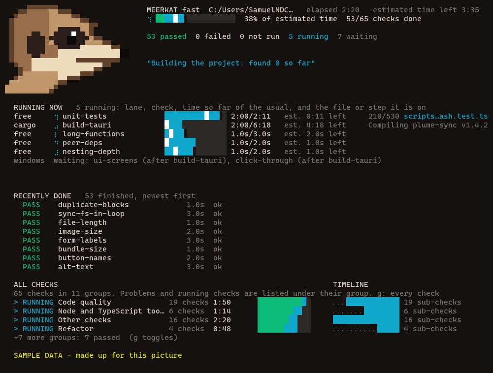
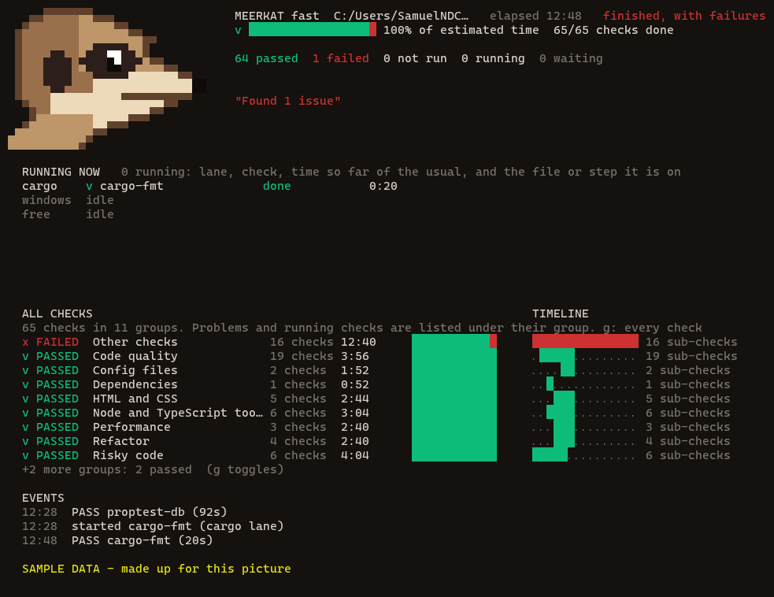

# Meerkat

**Meerkat checks an app before you push it.** It builds the app, runs every check it can find, opens the real thing in a hidden window and clicks through it, and tells you plainly what passed, what failed and what could not run. It is made for **Rust apps** and for apps that run in **Electron or a Chromium window**, and it is built so you can swap its checks and tools for your own.



## Why it exists

"Is this safe to push?" used to mean running about ten commands in the right order and knowing which needed the Rust build first. Meerkat is one command:

- **It looks at the real app.** It opens the app in a window parked off-screen, walks every page and control, presses them and reads the screen. A passing unit test cannot see a heading covered by a banner. This can.
- **It never passes quietly.** A tool that is not installed, or a check that cannot start, is reported **NOT RUN**, and a run with a NOT RUN or a failure exits with an error. Nothing is skipped to look green.
- **It checks itself.** `--self-test` feeds every check a deliberately broken case and expects a failure, so a check that stopped working is caught.
- **It never interrupts you.** Test windows cannot open File Explorer, pickers, dialogs or downloads, and cannot take focus.
- **It is fast, and kind to your PC.** Light checks run side by side, heavy ones run when there is room, and only one Rust build runs at a time (see below).

## Try it

You need [Node.js](https://nodejs.org) 20 or newer. Meerkat has no runtime dependencies.

```
git clone https://github.com/SamuelNDCE/Meerkat.git
```

Then, from the folder of the project you want to check:

```
node path/to/Meerkat/run.mjs --init
```

```
node path/to/Meerkat/run.mjs
```

`--init` looks at your project and writes a starting `meerkat.config.json` (a Cargo project gets the Rust and security packs). To see the board and its animations without any project, run a fake run:

```
node preview.mjs --speed 6
```

## What you can run

One command, different amounts of checking. `--preset` picks one; `--list` shows every check and `--estimate` says how long a run should take on your PC.

| Command | What it runs | When to use it |
|---|---|---|
| `node run.mjs` | every quick check (same as `--preset quick`) | before every push |
| `--preset full` | everything: every control in several looks, accessibility, fuzzing, mutation testing, the Rust tests | before a promotion or a release |
| `--preset security-fast` | the quick security checks: secret scan, dependency advisories, source rules | any time, a few seconds |
| `--preset security` | every security check, including fuzzing and mutation testing | before a release |
| `--preset ui-fast` / `--preset ui` | only the real-window checks, quick or complete | after a UI change |
| `--preset app-fast` / `--preset app` | UI and functionality together | after a feature |
| `--group security,ui` | any mix of the four kinds: `security`, `functionality`, `ui`, `performance` | your own mix |
| `--self-test` | proves every check still fails on a broken case | after changing Meerkat or a tool |

A focused run brings what its checks need with it (a UI check pulls in the build it waits for). Your own named runs go in `meerkat.config.json` under `presets`.

## How long it takes

Measured on one PC (Ryzen 5 7600, 6 cores and 12 threads, 31 GB), on a clean checkout of a large Rust and Electron app. A run's total is close to its longest check, because the rest run beside it.

@@TIMES@@

Run `node run.mjs --estimate` (or `--preset full --estimate`) for the figure on your own machine. It uses the times Meerkat has measured there, run through the same scheduling rules.

## How it stays fast without crashing your PC

- **Order:** a check that others wait on (a build) starts first, and quick checks go ahead of it so a quick failure shows up at once.
- **Light together, heavy alone:** every check has a cost in processor threads and memory. Light checks (a scan, a lint, an audit) run side by side, about as many as the machine has threads. A heavy one (a build, the unit tests, a click-through with many windows) starts only when the machine has room, so mostly it runs alone. Free memory is read each time, so a PC that is busy with something else starts fewer checks, and one check can always run alone, so a run never gets stuck.
- **At most 5 at once by default.** `budget.maxParallel` in `meerkat.config.json` changes it (raise it for a run that is only light checks). A check marked `alone` runs with nothing beside it.
- **One Rust build at a time**, machine-wide: several cargo builds at once once froze a machine. **One window job at a time** too.
- **It learns your PC.** It keeps the real time of each passing check and uses it for the order, the bar and the countdown, which is a simulation of the rest of the run and falls one second per second.
- **Separate build folders where they would collide.** The Rust test check builds in its own folder so it cannot fight a window check over the program the window is running.

The scheduler itself costs milliseconds; the time is in the tools it runs (cargo, a browser), so rewriting it in another language would not make a run faster.

## What it checks

| Kind | Checks |
|---|---|
| Security | secret scan (keys, tokens, private keys), `npm audit`, `cargo audit`, source rules, parser fuzzing, mutation testing of security rules, optional staging scans |
| UI | real-window click-through (every page and control, several looks and window sizes), accessibility scan on every screen, screenshots of the main pages, test-window safety |
| Functionality | type check, Rust format, lints and tests, every unit test, release build, the app starting for real |
| Performance | optional sync-server load test |

Every check, what it catches and what it needs: [`docs/checks.md`](docs/checks.md). The packs below fit any Cargo or Node project; the checks in the first group were written for the app Meerkat was first built for and are being generalised ([`docs/roadmap.md`](docs/roadmap.md)).

### Packs: add what your project needs

Run `node run.mjs --list` for the live list; the counts below are a snapshot from 2026-10-31.

| Pack | Checks | What it is for | Needs set up first |
|---|---|---|---|
| (built in) | 27 | the Electron + Rust app Meerkat was made for: real-window click-through, accessibility, sidecar tests, mutation testing | that app's harness |
| `rust` | 5 | format, lints, tests, advisories, release build | `cargo` |
| `security` | 2 | secret scan, `npm audit` on every dependency | nothing |
| `hygiene` | 11 | license, tracked keys and `.env` files, oversized files, lockfiles, JSON that parses, merge-conflict markers, npm scripts that point at missing files, FIXME notes, broken document links, page accessibility basics, Rust `unsafe` without a reason | nothing |
| `performance` | 6 | size budgets, dependency weight, start-up time, response time, a load burst, build time | budgets in `.meerkat-budgets.json` |
| `ai` | 2 | a model audits every route and handler, and reviews your diff, for bugs and security holes | opt-in: `--include ai` |

**Performance budgets.** A performance check with no budget is reported NOT RUN and prints the exact lines to add, so an unset budget is never mistaken for a pass. Put them in `.meerkat-budgets.json` at the repository root:

```json
{ "perf": {
    "sizes":     [{ "path": "dist", "maxKB": 2048 }],
    "startup":   { "cmd": "node", "args": ["server.js"], "readyText": "listening", "maxMs": 3000 },
    "endpoints": [{ "url": "http://127.0.0.1:3000/health", "maxMs": 200 }],
    "load":      { "url": "http://127.0.0.1:3000/", "requests": 500, "concurrency": 20, "maxP95Ms": 500 },
    "build":     { "cmd": "npm", "args": ["run", "build"], "maxSeconds": 120 } } }
```

The load burst only aims at this machine unless you add `"allowRemote": true`, so it cannot hammer a live server by mistake.

**Setting up the license check.** The check fails until the repository says how others may use it. Pick a license (<https://choosealicense.com> explains the common ones), save its text as `LICENSE` at the top of the repository, and put the same name in `package.json` (`"license": "MIT"`) or `Cargo.toml` (`license = "MIT"`). It also lists any installed dependency under a copyleft license (GPL, AGPL and similar), so you decide whether that fits how you ship. Meerkat flags these; it does not give legal advice.

**The AI audit.** `ai-route-audit` finds every HTTP route, IPC channel and command handler by pattern (`node thorough/ai.mjs routes` lists them and sends nothing), then asks a model to look for missing authentication, injection, path traversal and logic bugs in each. `ai-diff-review` does the same for what changed against your main branch. By default it uses your own Claude Code login; point `MEERKAT_AI_CMD` at any command that reads a prompt on stdin and prints an answer to use another model. It prints what it will send before sending, blanks secret-looking values first, and treats the code as data, not instructions. High and critical findings fail the run; lower ones are listed. A model can miss things and can be wrong, so treat it as an extra reader, not a replacement for the other checks.

## Make it fit your project

Everything is a plain file: choose which checks run, swap a tool for another, add checks of your own, set how much of the machine a run may use. Mistakes in the file are printed as notes and never stop a run, and a swapped tool must prove itself with its own self-test. See [`docs/customizing.md`](docs/customizing.md).

## Tools it uses

Meerkat drives other tools and reports on them; it does not replace them. A missing one is NOT RUN.

| Job | Tool |
|---|---|
| Type check | TypeScript (`tsc`) |
| Unit tests | Vitest |
| Rust | rustfmt, clippy, `cargo test`, `cargo audit`, `cargo-mutants`, proptest fuzzing |
| Dependency advisories | `npm audit`, `cargo audit` |
| Real windows | Electron, parked off-screen, with a test-safety layer |
| Accessibility | axe-core inside those windows |
| Opt-in extras | k6 (load test), ZAP and Nuclei (staging scan), Snyk agent scan |

## The look

A pixel-art meerkat watches the run. It looks straight ahead and blinks, squints when everything passed, and stares wide-eyed when something failed. Status is always a word as well as a colour, so the look never hides a result. `NO_COLOR` turns colour off; `NV_VERIFY_PLAIN=1` gives plain lines; a pipe or CI gets plain lines automatically.



`node run.mjs --ui` draws the board in a real terminal. It has a loading screen while it gets ready, and `node watch.mjs` in a second terminal follows a run without touching it. Colours, spinner and speed can be tuned in `~/.nv-verify-theme.json` ([`docs/customizing.md`](docs/customizing.md)).

## Status

- Working: the fast and thorough tiers, presets, the scheduler, the config file, the Rust and security packs, the board and its loading screen.
- Not yet: checks for Chromium-based apps and plain Node projects beyond the security pack, a generic window harness for apps other than the one Meerkat was first written for, running after a build automatically, and a licence (none is chosen yet; the code carries no copyright or proprietary notices because it is meant to be opened up).

More: [`docs/setup.md`](docs/setup.md) (set-up on a new machine), [`docs/roadmap.md`](docs/roadmap.md), [`docs/speed.md`](docs/speed.md), [`PROJECT.md`](PROJECT.md) (rules for working in this repository). Meerkat's own tests: `npm test`.
