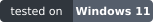

<div align="center">

# Meerkat

        <a href="https://github.com/SamuelNDCE/Meerkat/actions/workflows/ci.yml"></a>  <a href="https://perpetualtechnologies.co.uk"></a> 

**One command that checks your whole project before you ship it.**<br>
Security, correctness, accessibility, performance and code health, for any kind of app, with every result saved and explained.

<!-- counts:start -->
**360 checks · 1406 sub-checks · 47 suites.** A check is one scan or tool run; a sub-check is one rule inside it, so a failure names the exact rule. These are the checks Meerkat ships: any you add yourself are extra.
<!-- counts:end -->


<sub>Sample data: a made-up project, drawn by Meerkat's real screens.</sub>

**[Why](#why-meerkat) · [Features](#what-you-get) · [Quick start](#quick-start) · [What it looks like](#what-it-looks-like) · [Make it yours](#make-it-yours) · [Commands](#commands) · [Reference](docs/reference.md) · [Licence](#licence)**

</div>

## Why Meerkat

"Is this safe to push?" usually means running ten commands in the right order, remembering which tool needs which flag, and reading ten different kinds of output. Most projects never get further than a linter and a few tests, so whole classes of problem (a leaked key, an unescaped query, a button a screen reader cannot reach, a build that only works on your machine) ship unseen.

Meerkat is one command that runs all of it, works out what applies to your project, and gives you one honest answer.

**What it solves**

| The problem | What Meerkat does |
|---|---|
| Checks are scattered across tools, scripts and CI | One command runs them all, in the right order, and shows one result |
| A tool is missing and the check silently skips | It says **NOT RUN** and why, and the run exits with an error. It never passes quietly |
| Scanners cry wolf, so people stop reading them | Every rule is proven on a bad and a good sample, and a planted-bug test measures misses and false alarms |
| You cannot tell why something failed | Every check's command, exit code, time and full output is saved, with a findings file worst-first |
| Different project types need different tools | It detects what you have (Node, Rust, Python, Go, Electron, web, Docker and more) and runs what fits |
| Big projects time out, small ones wait | Time limits grow with the size of the project and your PC, and stuck checks are skipped, not waited on |

**Why it is good**

- **Honest.** NOT RUN is never a pass. A check that stopped working is caught by `meerkat self-test`.
- **Accurate.** Over a thousand rules, each with its own bad and good sample, plus a corpus of planted defects. Recall and false-alarm rates are committed to the repository, see [docs/accuracy.md](docs/accuracy.md).
- **Fast.** The quick preset runs every short check in seconds. Light checks run together, heavy ones run alone.
- **Private.** Zero dependencies, no telemetry, nothing uploaded. The one network call is a once-a-day version look-up you can turn off.
- **Yours.** Add a command as a check in one line, write a check in JavaScript, make your own presets, silence a known finding with a reason.
- **Readable by people and machines.** A live board and a results screen for you; JSON, SARIF, Markdown and an MCP server for scripts, CI and AI agents.

## What you get

| Feature | In one line |
|---|---|
| **Presets** | `quick` before every push, `full` before a release, plus security, ui, performance, refactor, ci and more |
| **Suites and sub-checks** | Checks grouped by topic; each reports every rule it tested, so a failure names the exact rule |
| **Live board** | Progress, what is running now, a status line, a bug counter by severity, a timeline; skip a stuck check with a key |
| **Results screen** | Findings worst-first with severity in words and colour and a reason, every check with its time, a scrolling timeline |
| **Findings files** | `findings.json`, `findings.md` and `findings.sarif` per run, and a history of what is new since last time |
| **Your project's own tests** | Found automatically (`meerkat discover`) and run as checks, with a guard against a test that hangs |
| **Smart timeouts** | Limits scale with project size and your PC; `--timeout-scale` and `--max-run-minutes` when you want control |
| **Estimates** | The menu and board show how long a run should take for this project, learned from your history |
| **Deeper checks** | Mutation testing and runtime checks (clean-copy build, flaky tests, timezone matrix and more), on request |
| **AI prompt** | Press `p` on the results screen for a ready-made prompt that hands every finding, in full, to an AI to verify and fix |
| **AI checks and verification** | Optional. Off by default; they say what they will send before they send it |
| **Updates** | Your version and the newest one are shown on the menu and results screen; one key installs it |
| **Logs** | One folder per run named with the project and preset; `meerkat why <check>` explains a failure |

Every check, with what it needs and how long it takes, is listed in [docs/checks.md](docs/checks.md). It is generated from the checks themselves, so it cannot drift from the code.

## Quick start

You need [Node.js](https://nodejs.org) 20 or newer. There is nothing else to install.

```
git clone https://github.com/SamuelNDCE/Meerkat.git
```

Install the `meerkat` command once, from the folder you cloned:

```
npm link
```

Then, in any project folder:

```
meerkat verify
```

Or point it at a folder by path or by name:

```
meerkat verify C:\code\my-app
```

Run `meerkat` on its own for the menu: pick the project (the folder you are in, projects you used lately, or any git repository it finds), then pick a preset. Each row shows an estimate for that project. Press `d` to see what a preset runs, `u` to update Meerkat, Esc to go back.

Without `npm link`: `node path/to/Meerkat/run.mjs --app <folder> --preset quick`.

## Connect it to your project

Meerkat reads your project from the outside: it never edits it, and its own files stay in `~/.meerkat` (or the folder in `MEERKAT_LOG_DIR`). To use it on a project:

| Where | How |
|---|---|
| One-off, from the project folder | `meerkat verify` |
| By path or by name, from anywhere | `meerkat verify C:\code\my-app` or `meerkat verify my-app` (tell Meerkat where your projects live once with `meerkat root add <folder>`) |
| Before every push | add a `.git/hooks/pre-push` file containing `meerkat verify --plain` (a failure or a NOT RUN stops the push) |
| On every pull request | the [CI job below](#using-it-in-ci) |
| Settings for this project | `meerkat init` writes a `meerkat.config.json`; limits and accepted findings live in a `.meerkat/` folder |

Meerkat only checks real projects: a git repository, or a folder with a recognised marker such as `package.json`, `Cargo.toml` or `pyproject.toml`. Anything else is refused with a clear message (`--force` overrides it).

## What it looks like

Every picture here is **sample data**: a made-up project, not a real run.

**1. Pick what to run.** The menu lists the presets with an estimate for your project, shows your version, and shows the newest one in yellow when an update is waiting.


**2. Watch it run.** The animation at the top is the live board: what is running now, the status line, every group of checks with its time, and the timeline.

**3. Read the results.** The results screen lists the findings worst first, each with its severity, rule, file, line and why it matters (critical means fix before shipping, high means fix soon, medium means should fix, low and info are worth knowing). Tab switches between the findings, every check with its time, and the timeline; Up and Down scroll.


**4. When nothing is wrong,** Meerkat says so, and looks pleased about it.


## What it works on

Meerkat looks at what is in your folder and runs what fits. Checks that need an outside tool you have not installed say **NOT RUN** and how to install it.

| Your project | What you get |
|---|---|
| Anything in git | secret scan, risky code, dependency and workflow checks, licence, large files, lockfiles, links, imports, JSON, env documentation |
| JavaScript and TypeScript | ESLint, TypeScript, Prettier, circular imports, unused exports, `npm audit` |
| Rust | format, Clippy, tests, advisories, docs, release build, `unsafe` without a reason |
| Python | Ruff, mypy, pytest, Bandit, dead code |
| Go, Java, .NET, PHP, Ruby, Swift, Dart | build, test, format and lint with each ecosystem's own tools |
| Web pages and front ends | HTML and CSS linters, accessibility, security headers, meta tags |
| Electron and desktop apps | window security, IPC, fuses, signing, packaging, and an example pack that clicks through every page |
| APIs and servers | route checks, injection and traversal patterns, CORS, cookies, load and response time |
| Docker, Terraform, Kubernetes, CI | Dockerfile and Compose rules, `terraform fmt`, `helm lint`, workflow hardening |
| Data science and docs | notebooks, dataset licences, Markdown, typos, local links |

Meerkat was developed and tested on Windows 11 and runs its own test suite in CI on Windows, macOS and Linux (see [CI](#using-it-in-ci)).

## Make it yours

Meerkat is built to be extended without touching its code.

| To | Do this |
|---|---|
| Add a command you already run | `meerkat check new --id e2e --cmd "npm run test:e2e" --yes` |
| Get suggestions for tests your project can run | `meerkat recommend` |
| Make a preset of your own | `meerkat preset new --name pre-push --tier fast --group security,ui --personal` |
| Write a check in JavaScript | a file in `.meerkat/checks/`, found with no setting |
| Share a folder of checks | `meerkat pack add <folder>` |
| Turn a check, a suite or one rule off | `"disable"` and `"disableSubs"` in `meerkat.config.json` |
| Silence one known finding, with a reason | a line in the matching `.meerkat-<area>-allow` file |
| Leave files out of the scans | list them in `.meerkatignore` |
| Set limits for your project | `.meerkat-budgets.json` (line length, complexity, timeouts and more) |

Your settings for every project live in `~/.meerkat.json`; settings for one project live in its `meerkat.config.json`. A five-minute walk-through: [docs/customizing.md](docs/customizing.md). Writing a check: [docs/writing-checks.md](docs/writing-checks.md).

## Commands

Everything the menu does is also a command, so scripts, CI and AI agents never need the screen. Add `--plain` for plain lines and `--json` where a script needs data.

| I want to | Type |
|---|---|
| run the quick checks on this folder | `meerkat verify` |
| run a preset on a project by path or name | `meerkat full C:\code\my-app` or `meerkat security my-app` |
| run one suite, or one check of it | `meerkat check secrets` or `meerkat check secrets/secret-scan` |
| run a few named checks | `meerkat check clippy rust-tests eslint` |
| see what would run and what could not | `meerkat doctor` and `meerkat check list` |
| see the presets and their estimates | `meerkat presets` |
| include the slow extras | `meerkat full --include runtime --include mutation` |
| give slow machines or big projects more time | `meerkat full --timeout-scale 2` |
| stop a run that goes on too long | `meerkat full --max-run-minutes 30` |
| read the last report, one check's log, the findings | `meerkat last`, `meerkat why <check>`, `meerkat findings` |
| list the tests your project already has | `meerkat discover` |
| update Meerkat | `meerkat update` |
| print a bug report to paste into an issue | `meerkat bug` |

The exit code is 0 when everything passed, 1 when something failed and 75 when something could not run. Every command and flag: [docs/commands.md](docs/commands.md) and the full [reference](docs/reference.md).

## For AI agents and scripts

Meerkat is built to be driven by tools as well as people: plain output, `--json`, SARIF for code-scanning, an MCP server (`bin/meerkat-mcp.mjs`) with `meerkat_run`, `meerkat_last`, `meerkat_why` and more, and a stable findings protocol (`MEERKAT-FINDING` lines). Start at [docs/for-ai-agents.md](docs/for-ai-agents.md).

### AI prompts and verification

After a run, Meerkat can write a prompt for an AI that has never seen it:

```
meerkat prompt
```

On the results screen press `p`. Meerkat writes `ai-prompt.md` into the run folder and copies one short line to your clipboard that points your AI at it. The file explains what Meerkat is and what the results mean, then lists every finding in full (critical, high, medium, low, info), what could not run, and instructions to verify each finding, fix the real ones from the highest severity, and run `meerkat verify` again. Everything copied from your project is fenced and marked as untrusted data.

Optional and off by default: `meerkat verify --ai-verify` (or `v` on the results screen) asks the model you chose with `meerkat ai use` to double-check each medium, high and critical finding. It tells you exactly what it will send (the finding, about 30 lines of code around it with secrets removed, and the rule description) and asks first unless you pass `--yes`. Verdicts only add notes to findings; nothing is deleted, and a model error means NOT RUN, never a pass.

Every run also saves `run.log`, a timestamped record of how it went. Details: [docs/reference.md](docs/reference.md), [docs/logs.md](docs/logs.md), [docs/findings.md](docs/findings.md).

### Connect Meerkat to NeuralVault, Claude Code or any MCP client

`bin/meerkat-mcp.mjs` is an MCP server (stdio, Node 20+, nothing sent over the network). It gives an AI agent six tools: `meerkat_run`, `meerkat_last`, `meerkat_why`, `meerkat_list`, `meerkat_presets` and `meerkat_self_test`.

**NeuralVault** (from the `nv` command line; the same connector then shows in the app's settings):

```
nv mcp add meerkat --command node --grant-read-only meerkat_last --grant-read-only meerkat_why --grant-read-only meerkat_list --grant-read-only meerkat_presets --grant meerkat_run -- C:\code\Meerkat\bin\meerkat-mcp.mjs
```

```
nv mcp test meerkat
```

The read-only tools can only read results; `meerkat_run` is the one that starts a run, so grant it only to agents you want to run checks. **Claude Code:** `claude mcp add meerkat -- node <path>/bin/meerkat-mcp.mjs`. Other clients: [docs/for-ai-agents.md](docs/for-ai-agents.md).

**About NeuralVault.** NeuralVault is an agent harness you own, made by [Perpetual Technologies](https://perpetualtechnologies.co.uk): it remembers how your business works, acts only where you allow it, and keeps a record of everything it does. Meerkat started as the verification layer for it, and works on any project on its own. Learn more at [perpetualtechnologies.co.uk](https://perpetualtechnologies.co.uk).

## Using it in CI

Meerkat exits non-zero on any failure or NOT RUN and writes `summary.json` for every run. A minimal GitHub Actions job:

```yaml
- uses: actions/setup-node@v4
  with: { node-version: 20 }
- run: git clone https://github.com/SamuelNDCE/Meerkat.git "$RUNNER_TEMP/meerkat"
- run: node "$RUNNER_TEMP/meerkat/run.mjs" --preset ci --json meerkat.json
```

Meerkat's own repository runs its test suite on Windows, macOS and Linux with Node 20 and 22 in [.github/workflows/ci.yml](.github/workflows/ci.yml).

## Versions and updates

Meerkat uses [semantic versioning](https://semver.org): the last number is the fix number (0.3.1 is the first fix to 0.3.0), the middle number adds features (0.4.0), and the first changes how you use it (1.0.0). Every fix release bumps the last number, so you can always tell which fixes you have. The version lives in `package.json`, and everything that shows it (menu, results screen, board, badge) reads it from there. [CHANGELOG.md](CHANGELOG.md) says what changed in each version.

When a newer version is published here, the menu, the results screen and the live board show a yellow line with your version and the new one. Every kind of update shows: a new feature version, a fix number, and even a fix published without a new number (it shows as the version plus the number of new changes, for example 1.2.3+3). `meerkat update` installs it after you say yes. Meerkat looks once a day, read-only, and never installs without your yes (`meerkat update off` turns the look-up off). Maintainers cut a version with `node tools/release.mjs minor "what changed"`.

## Privacy

Meerkat has no telemetry and never uploads your code or your results. Its one network call of its own is the update look-up. The tools it runs may use the network (`npm audit` asks its registry; performance checks call only the URLs you give). The AI checks are opt-in and say what they will send before they send it.

## Share what you build

If you wrote a check, a pack or a preset that other people would find useful, please share it: open an issue or a pull request at [github.com/SamuelNDCE/Meerkat](https://github.com/SamuelNDCE/Meerkat) (see [CONTRIBUTING.md](CONTRIBUTING.md)), or publish your pack folder and tell us. Checks that find real problems on real projects without false alarms are the most valuable. To report a security problem, see [SECURITY.md](SECURITY.md).

## Keeping the rules accurate

Rules change as new bugs are found. If Meerkat reports something that is fine, open a [false alarm](https://github.com/SamuelNDCE/Meerkat/issues/new?template=false-positive.yml) issue; if it misses a real problem, open a [missed problem](https://github.com/SamuelNDCE/Meerkat/issues/new?template=missed-bug.yml) issue. Every fix ships with a sample that proves it and is listed in [CHANGELOG.md](CHANGELOG.md). Accuracy is measured against a corpus of planted defects, see [docs/accuracy.md](docs/accuracy.md).

**On the roadmap:** syncing rules and advisories automatically from trusted vulnerability sources, so Meerkat also works as a vulnerability checker ([issue 26](https://github.com/SamuelNDCE/Meerkat/issues/26)).

## Licence

Meerkat is under the [Perpetual Community Licence 1.0](LICENSE), written for this project:

- **People** can use, change and share it for anything, free.
- **Organisations** can use it free too, but must say publicly that they use it, with a link to this repository.
- **Nobody may sell Meerkat itself** or run it as a paid service for others. A company that builds it into its own product and sells *that* may, if it credits Meerkat and links here. Extensions you write are yours to sell.
- **No telemetry**, and nothing is sent to an AI model unless you turn that check on.

The numbered terms in [`LICENSE`](LICENSE) are what counts; this summary is a guide. It is not an OSI open-source licence (it restricts selling) and has not been reviewed by a solicitor. See [docs/licence-notes.md](docs/licence-notes.md).

## More documentation

| Read | For |
|---|---|
| [docs/reference.md](docs/reference.md) | the full manual: presets, settings, environment variables, timeouts, logs |
| [docs/checks.md](docs/checks.md) | every check and suite |
| [docs/commands.md](docs/commands.md) | every command and flag |
| [docs/tiers.md](docs/tiers.md) | what runs in quick and what in full |
| [docs/findings.md](docs/findings.md) | the findings files and protocol |
| [docs/discover.md](docs/discover.md) | your project's own tests |
| [docs/accuracy.md](docs/accuracy.md) | how accuracy is measured |
| [docs/mutation.md](docs/mutation.md), [docs/functionality-run.md](docs/functionality-run.md), [docs/robustness.md](docs/robustness.md) | the deeper checks |
| [PROJECT.md](PROJECT.md) | rules for working in this repository |
